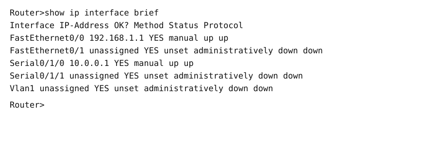
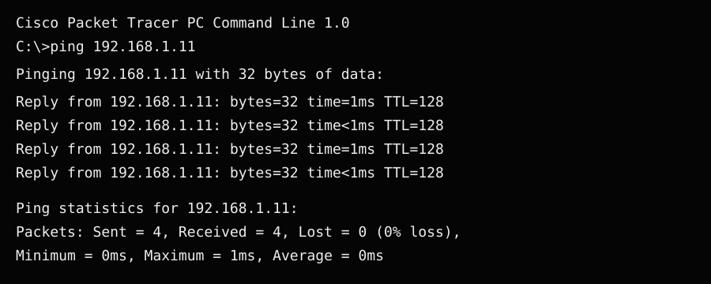
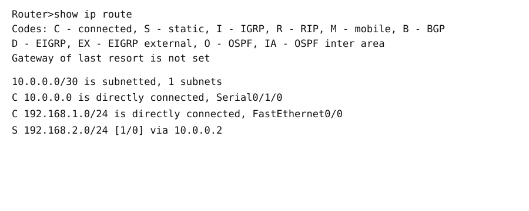

# IP Configuration and Basic Network Connectivity

> **Practical report · Cisco Packet Tracer · IPv4 addressing · Ping and routing verification**

## 1. Practical Overview

In this practical, a small network was created in Cisco Packet Tracer using two routers, two switches and six PCs. The devices were connected and configured so that the role of IP addressing and network connections could be understood. The practical evidence includes interface-status output, routing-table output, ping tests and a screen recording.

## 2. Practical Details

| Item | Details |
|---|---|
| Practical name | IP Configuration and Basic Network Connectivity |
| Software | Cisco Packet Tracer |
| Devices | 2 routers, 2 switches and 6 PCs |
| Main concepts | IPv4 addresses, subnet masks, default gateways, router interfaces, routing tables and ICMP |
| Verification | `show ip interface brief`, `show ip route` and `ping` |
| Project file | [practical1.pkt](./practical1.pkt) |

## 3. Objective

To build and verify a basic network in Packet Tracer, understand how devices are connected, inspect router interface configuration, and test communication between PCs using ping.

## 4. Network Overview

The topology uses routers to connect network segments, switches to connect local devices, and PCs as end hosts. Each PC must have a valid IP address and subnet mask. Where a PC needs to communicate outside its own subnet, its default gateway must point to the appropriate router interface.

### Network topology and project

Open [practical1.pkt](./practical1.pkt) in Cisco Packet Tracer to inspect the saved topology.

## 5. Procedure

1. Open Cisco Packet Tracer and create or open the practical workspace.
2. Place two routers, two switches and six PCs in the workspace.
3. Connect the PCs to the switches and the switches to the routers using suitable Ethernet cables.
4. Connect the routers using the link type required by the saved topology.
5. Configure the IPv4 address and subnet mask on each required router interface.
6. Enable the required interfaces and check their operational status.
7. Configure each PC's IP address, subnet mask and default gateway according to its LAN.
8. On the router CLI, run `show ip interface brief` to check the interface addresses and status.
9. Run `show ip route` to inspect directly connected and any configured or learned routes.
10. Open a PC's **Desktop → Command Prompt** and use `ping <destination-ip>` to test connectivity.
11. Send a Simple PDU in Simulation Mode if you want to observe the packet path.
12. Save the Packet Tracer project and keep the screenshots and screen recording with the report.

> Use the actual addressing in the supplied Packet Tracer file. This report does not assume IP addresses that are not shown in the evidence.

## 6. Verification Commands

### Check interfaces

```text
show ip interface brief
```

This command lists router interfaces, their IP addresses, and their status/protocol state. An interface showing **up/up** is operational at both the physical and data-link protocol levels.

### Inspect the routing table

```text
show ip route
```

This command displays the routes the router can use to forward packets. Route codes identify how a route was learned, such as directly connected or dynamically learned.

### Test connectivity

```text
ping <destination-ip>
```

Ping sends ICMP Echo Requests and checks for replies. Successful replies indicate that the destination responded to the test.

## 7. Screenshots and Video

### 7.1 Interface status



This image illustrates the interface-status command and is included as supporting documentation.

### 7.2 PC-to-PC ping



Use this evidence to explain how ping is used to test connectivity between end devices.

### 7.3 Routing table



The routing table helps show which networks the router knows and how routes are represented.

### 7.4 Additional interface-status image


This is an additional illustration of interface status.

### Demonstration video

**[▶ Watch / download the IP Configuration practical video](./media/Screen%20Recording%202026-09-08%20202717.mp4)**

### Packet Tracer project

**[Open/download practical1.pkt](./practical1.pkt)** — open this file with Cisco Packet Tracer to inspect the topology and configuration.

## 8. What Each File Contains

| File | Description |
|---|---|
| `01-IP-CONFIGURATION.md` | Main practical report, including the overview, procedure, verification commands and learning outcomes |
| `practical1.pkt` | Cisco Packet Tracer project file containing the saved network lab |
| `media/01-show-ip-interface-brief.svg` | Supporting illustration for interface addresses and status |
| `media/02-ping-pc0-to-pc1.svg` | Supporting illustration for a PC-to-PC ping test |
| `media/03-show-ip-route.svg` | Supporting illustration for the routing table |
| `media/04-show-ip-interface-brief-duplicate.svg` | Additional interface-status illustration |
| `media/Screen Recording 2026-09-08 202717.mp4` | Screen recording associated with the practical |

## 9. What We Learned

- How to arrange and connect routers, switches and PCs in Cisco Packet Tracer.
- Why each network interface needs the correct IPv4 addressing.
- How subnet masks help devices identify their local network.
- Why PCs need a correct default gateway to reach other networks.
- How to use `show ip interface brief` to check interface addresses and status.
- How to use `show ip route` to inspect a router's known routes.
- How to use ping to test connectivity between devices.
- How Simulation Mode can help visualize packet movement.
- How to document a networking practical with a project file, screenshots and a video.

## 10. Result

The practical documents the setup and verification of a small Packet Tracer network. The saved project and supporting evidence can be used to review the device connections, interface configuration, routing information and connectivity-testing process.
