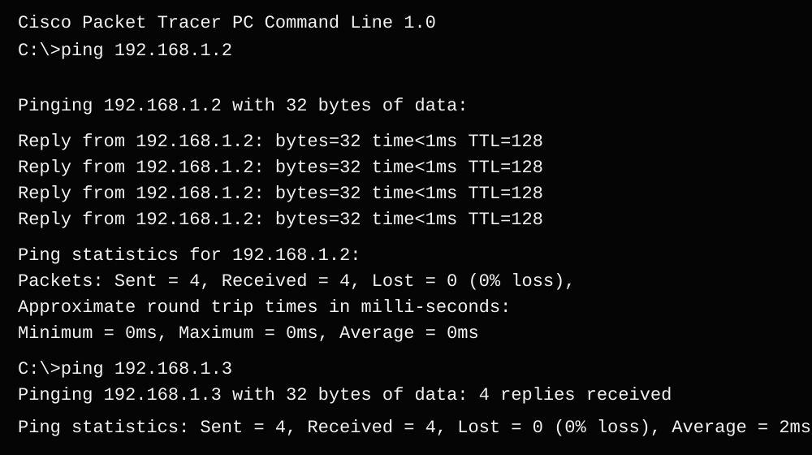

# STP (Spanning Tree Protocol) Practical

> **Cisco Packet Tracer · Layer 2 switching · Redundant links · Loop prevention**

## 1. Practical Overview

This practical demonstrates how Spanning Tree Protocol (STP) helps prevent Layer 2 switching loops in a network that contains redundant links. Three Cisco 2960 switches are connected in a triangle, creating more than one possible path between switches. STP selects a root bridge and places a redundant port into a blocking state so that the active topology remains loop-free.

Three PCs are connected to the switches. After configuring STP, ping tests from PC1 to PC2 and PC3 are used to verify end-to-end connectivity.

## 2. Practical Details

| Item | Details |
|---|---|
| Practical name | Basic Practical: STP (Spanning Tree Protocol) |
| Software | Cisco Packet Tracer |
| Switches | 3 × Cisco 2960 (S1, S2 and S3) |
| End devices | 3 PCs (PC1, PC2 and PC3) |
| Main topic | Spanning Tree Protocol and redundant switch links |
| Supporting concepts | Root bridge election, bridge priority, port roles, forwarding/blocking states and ICMP ping |
| Verification | `show spanning-tree`, `show spanning-tree vlan 1` and PC ping tests |

## 3. Objective

To create a redundant switched network in Cisco Packet Tracer, configure PVST on the switches, make S1 the preferred root bridge by assigning it a lower bridge priority, observe STP port states, and verify that the PCs can communicate without a Layer 2 loop.

## 4. Topology and IP Addressing

The topology contains three switches connected in a triangle, with one PC connected to each switch.

| Device | IPv4 address | Subnet mask | Connected switch |
|---|---|---|---|
| PC1 | `192.168.1.1` | `255.255.255.0` | S2 |
| PC2 | `192.168.1.2` | `255.255.255.0` | S1 |
| PC3 | `192.168.1.3` | `255.255.255.0` | S3 |

All three PCs are in the same `192.168.1.0/24` subnet. No default gateway is required for communication between these PCs because they are in the same IP subnet.

### Switch links

| Connection | Ports |
|---|---|
| S1 ↔ S2 | S1 Fa0/1 ↔ S2 Fa0/1 |
| S1 ↔ S3 | S1 Fa0/2 ↔ S3 Fa0/1 |
| S2 ↔ S3 | S2 Fa0/2 ↔ S3 Fa0/2 |
| PC1 ↔ S2 | PC1 Fa0 ↔ S2 Fa0/3 |
| PC2 ↔ S1 | PC2 Fa0 ↔ S1 Fa0/3 |
| PC3 ↔ S3 | PC3 Fa0 ↔ S3 Fa0/3 |

## 5. Files and Evidence

| File | Purpose |
|---|---|
| [STP ping results](./STP-Ping-Results.svg) | Readable recreation of the supplied PC1 ping screenshot |
| Packet Tracer project | The `.pkt` file is not currently in this folder; add it if you want others to open the lab in Packet Tracer |
| Original topology screenshot | The topology screenshot is not currently stored in this folder; upload it to add it to the report |
| Practical video | No STP video is currently stored in this folder |

## 6. Procedure

### Step 1 — Open Cisco Packet Tracer

1. Open Cisco Packet Tracer.
2. Select **File → New** to start a blank workspace.
3. Save the project later as `STP-Practical.pkt`.

### Step 2 — Add the network devices

1. From the bottom-left device panel, select **Network Devices → Switches**.
2. Drag three **2960** switches into the workspace.
3. Select **End Devices** and add three PCs.
4. Arrange the switches in a triangle: S1 at the top, S2 at the lower left and S3 at the lower right.
5. Place PC1 near S2, PC2 near S1 and PC3 near S3.
6. Use the device display names or labels to identify S1, S2, S3, PC1, PC2 and PC3 clearly.

### Step 3 — Connect the switches and PCs

1. Select **Connections** (the lightning-bolt icon).
2. Use a suitable Ethernet cable for each switch-to-switch connection. Copper Cross-Over can be used for this Packet Tracer lab; supported 2960 auto-MDIX behaviour may also allow a straight-through cable.
3. Connect S1 Fa0/1 to S2 Fa0/1.
4. Connect S1 Fa0/2 to S3 Fa0/1.
5. Connect S2 Fa0/2 to S3 Fa0/2.
6. Connect each PC to its switch using Copper Straight-Through:
   - PC1 Fa0 to S2 Fa0/3.
   - PC2 Fa0 to S1 Fa0/3.
   - PC3 Fa0 to S3 Fa0/3.
7. Wait for the link indicators to settle. A redundant path may change state while STP converges.

### Step 4 — Configure the PC IP addresses

For each PC:

1. Click the PC.
2. Open **Desktop → IP Configuration**.
3. Select **Static**.
4. Enter the IP address and subnet mask from the table in Section 4.
5. Leave **Default Gateway** blank for this same-subnet lab.
6. Close the PC window and repeat for the other PCs.

### Step 5 — Configure S1 as the preferred root bridge

1. Click S1 and open the **CLI** tab.
2. If the initial configuration dialog appears, complete or exit it as appropriate.
3. Enter the following commands:

```text
enable
configure terminal
hostname S1
spanning-tree mode pvst
spanning-tree vlan 1 priority 4096
end
copy running-config startup-config
```

The lower bridge priority makes S1 the preferred root bridge for VLAN 1, assuming the other switches retain their default priorities.

### Step 6 — Configure S2

Open S2 → **CLI** and enter:

```text
enable
configure terminal
hostname S2
spanning-tree mode pvst
end
copy running-config startup-config
```

### Step 7 — Configure S3

Open S3 → **CLI** and enter:

```text
enable
configure terminal
hostname S3
spanning-tree mode pvst
end
copy running-config startup-config
```

### Step 8 — Verify STP

On each switch, enter privileged EXEC mode and run:

```text
show spanning-tree
show spanning-tree vlan 1
```

Check the following:

- **S1:** should report that it is the root bridge for VLAN 1.
- **S2 and S3:** inspect the root port, designated ports and alternate/blocking port state.
- **Redundant S2–S3 connection:** one end should be placed into an alternate/blocking state so the triangle does not create a forwarding loop.

The exact switch port that blocks can vary depending on bridge IDs and port costs. Record the state shown by your own Packet Tracer output rather than assuming a particular side must block.

### Step 9 — Test connectivity from PC1

1. Click PC1.
2. Open **Desktop → Command Prompt**.
3. Run:

```text
ping 192.168.1.2
ping 192.168.1.3
```

The supplied screenshot shows successful replies for both destinations. Each test reports **4 packets sent, 4 received and 0% packet loss**. If the first attempt times out, wait for STP and ARP to settle and repeat the ping.

### Step 10 — Observe the network in Simulation Mode

1. Switch Packet Tracer from **Realtime** to **Simulation**.
2. Open **Edit Filters** and select ICMP; include ARP if you also want to inspect address resolution.
3. From PC1, send a ping to PC2 or PC3.
4. Use **Capture / Forward** to advance the packet events.
5. Open event details to inspect the packet path.
6. Return to Realtime mode when finished.

### Step 11 — Save and capture evidence

1. Select **File → Save As**.
2. Save the project as `STP-Practical.pkt`.
3. Capture screenshots of the complete topology, S1's root bridge output, the STP port state showing the blocked redundant path, and successful PC1 ping results.
4. Add the screenshots, `.pkt` file and a practical recording to this folder if you want the repository to contain all original evidence.

## 7. Verification Commands

### Spanning Tree state

```text
show spanning-tree
show spanning-tree vlan 1
```

These commands show the root bridge, bridge ID, port roles and port states for STP.

### PC connectivity

```text
ping 192.168.1.2
ping 192.168.1.3
```

These commands test reachability from PC1 to PC2 and PC3.

## 8. Ping Test Results

### PC1 to PC2

Command: `ping 192.168.1.2`

**Observed result:** 4 sent, 4 received, 0% loss.

### PC1 to PC3

Command: `ping 192.168.1.3`

**Observed result:** 4 sent, 4 received, 0% loss.



The image in this repository is a recreated visual of the provided command-prompt screenshot, not the original uploaded PNG.

## 9. Main Concepts

### Spanning Tree Protocol (STP)

STP prevents Layer 2 loops in switched Ethernet networks that contain redundant links. It allows redundant physical connections to exist while selecting a loop-free forwarding topology.

### Root bridge and bridge priority

STP elects one switch as the root bridge. A lower bridge priority is preferred during root bridge election; setting S1's VLAN 1 priority to `4096` makes it preferred over switches left at the default priority.

### Port roles and states

STP determines how each switch port participates in the loop-free topology. A redundant path may be placed into an alternate/blocking state while other required ports forward traffic. Which end blocks depends on the STP election and path-cost decisions.

### Ping and ICMP

Ping tests whether a destination responds to ICMP Echo Requests. Successful replies from PC2 and PC3 show that PC1 can reach both destinations with the tested configuration.

## 10. What We Learned

- Why redundant switch links can cause Layer 2 loops.
- How STP creates a loop-free forwarding topology.
- How to configure PVST on Cisco switches in Packet Tracer.
- How bridge priority influences root bridge election.
- How to inspect root bridge information, port roles and blocking states with `show spanning-tree vlan 1`.
- How to assign IPv4 addresses to PCs in the same subnet.
- How to test PC-to-PC connectivity using ping.
- How to observe ICMP and ARP events in Simulation Mode.
- Why it is important to save the Packet Tracer project and capture configuration and verification evidence.

## 11. Result

The STP topology was tested with PC1 pinging PC2 (`192.168.1.2`) and PC3 (`192.168.1.3`). The supplied command-prompt evidence shows 0% packet loss for both tests. Use the switch STP output to confirm that S1 is the root bridge and that one end of the redundant S2–S3 path is blocking. Add the original topology screenshot, `.pkt` file and video to this folder when available to make the practical package complete.

## 12. Practical Demonstration Video

No STP demonstration video has been uploaded to this folder yet. After uploading the recording, add a link here using its exact repository filename.
